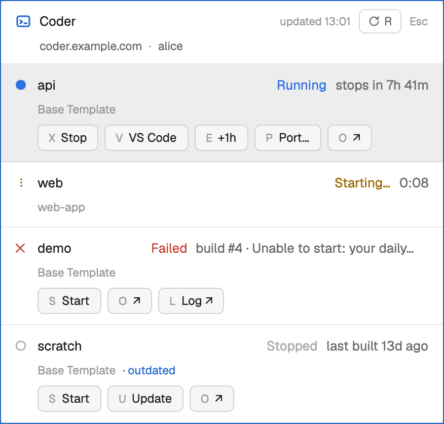

# Coder workspaces for the Herdr app

A mod for the [Herdr](https://herdr.dev) desktop app that lists your [Coder](https://coder.com) workspaces and lets you work on them from the keyboard, without opening the Coder dashboard. Press **Cmd+Shift+C** anywhere in the app: a small window opens with every workspace and its state, and **Esc** closes it.



This mod isn't made by or affiliated with Coder.

## What it does

For each workspace the window shows its state (running, starting, stopping, stopped, failed…), its template, whether it is outdated, when it will stop by itself, and the forwarded ports. It refreshes by itself: every 30 seconds, and every 3 seconds while something is changing.

| Key | Action | Offered when |
|---|---|---|
| `S` | **Start** | stopped, failed or canceled |
| `X` | **Stop** (asks first) | running |
| `V` | **VS Code**, connected to the workspace | running |
| `E` | **+1h**: the automatic stop moves one hour later, never earlier, and never past the template's limit | running with an automatic stop, and room to move it |
| `P` | **Port…**: forward a port to this computer (asks which: `3000`, or `8080:3000` for local:workspace) | running |
| `U` | **Update** to the template's new version (asks first on a running workspace, because it restarts) | outdated |
| `O` | **Open** the workspace's page in the browser | whenever the row has buttons |
| `L` | **Build log** of a failed build, in the browser | failed |
| `R` | Refresh | always |
| `↑` `↓` | Move the selection | always |
| `Enter` / `Esc` | Confirm / cancel the question that is open; `Esc` with none open closes the window | |

Every button shows its key, and a click does exactly what the key does. A workspace with an action under way shows what is happening (`Starting…`, `Stopping…`, `Updating…`) and no buttons until it settles or fails. When Coder can't be reached, isn't signed in, or isn't installed, the window says so in plain words and what to do next, and keeps the last list on screen, dimmed, when it has one.

Port forwards run as a tab in a space on this computer (one named "Coder" if you have it, otherwise your first), started in the background without moving your view. The row shows a `⇄ 3000` for each; selecting it brings the tab into view, and closing the tab ends the forward.

## What you need

- The Herdr app 0.1.12 or later, on macOS. Linux is best effort.
- The `coder` command-line tool, version 2.37 or later, signed in with `coder login <your deployment>`.
- VS Code with Coder's extension, for `V`.

## Install

Three ways. Whichever you use, the mod runs programs on your computer (it lists what in "What it runs"), so read that first.

1. **Through your Herdr agent**, with the line on the mod's page at herdr.dev. Tell it:

   ```
   Read ~/.config/herdr-app/AGENTS.md, then add this mod: herdr.dev/mods/vaibhavparnalia/herdr-coder-workspaces
   ```

   The agent tells you that the mod runs programs, then copies `mods/coder` into `~/.config/herdr-app/mods/coder`, merges `keys.json` into your keys, and runs `herdr-app check`.

2. **Through a mod manager** that lists mods with the `herdr-mod` topic: find the mod in its marketplace, review it (it flags that the mod runs programs), and install. The manager can then show when an update is out.

3. **By hand**: copy `mods/coder` from this repository to `~/.config/herdr-app/mods/coder`, and merge `keys.json` into `~/.config/herdr-app/keys.json`, keeping what is already there:

   ```json
   {
     "global": { "cmd-shift-c": "mod.open:coder" },
     "mod:coder": { "escape": "coder.close" }
   }
   ```

   If `cmd-shift-c` is already yours, pick another chord for it. Then check the mod:

   ```sh
   herdr-app check ~/.config/herdr-app/mods/coder
   ```

## The folder must stay named coder

The keys (`mod.open:coder`, `mod:coder`), the `coder.close` command and the icon paths all use the name `coder`. So the folder has to be `~/.config/herdr-app/mods/coder`.

If you already have another mod named `coder`, move it aside first: an agent that finds the name taken installs the new copy under another name, which doesn't work, and a mod manager refuses to install.

## Updating

Watch this repository's releases on GitHub (Watch → Custom → Releases). Each release's notes say what changed, whether the key bindings changed, and whether the mod runs anything new.

Then ask your agent to update it: replace `~/.config/herdr-app/mods/coder` with the release's `mods/coder`, rather than adding a second copy; merge `keys.json` again only if the notes say it changed; and run `herdr-app check` on the folder. `mods/coder/mod.json` says which version you have.

A mod manager updates the copies it installed, in place.

## What it runs

Everything the mod does goes through the `coder` tool on **this computer**, under your own sign-in, plus a few Herdr calls. Nothing else.

| To | It runs |
|---|---|
| List workspaces | `coder list --output json` |
| Know where you are signed in | `coder whoami --output json` |
| Start | `coder start --no-wait <owner/name>` |
| Stop | `coder stop -y <owner/name>` (after asking you) |
| Update | `coder update --use-parameter-defaults <owner/name>` |
| +1h | `coder schedule extend <owner/name> <N>m` |
| VS Code | `coder open vscode <owner/name>` |
| Forward a port | `hc run --bg … -- /usr/bin/env coder port-forward <owner/name> --tcp <L>:<R> --disable-autostart` (herdr-core, as a terminal on this computer; `/usr/bin/env` so that an `hc` template named `coder` can't run in its place), then `hc get`, `hc read` and `hc rm` for a forward that fails |
| Open a page | `open <url>` (macOS) or `xdg-open <url>` (Linux), only for a web link |
| Herdr | `tab.rename`, `space.rename` and `pane.focus` for forward tabs; a notification when an action ends |

Workspaces are always named `<owner>/<name>`. A workspace whose owner or name breaks Coder's own naming rule (letters and digits, in groups joined by single hyphens) can't come from a genuine Coder server, and is left out, so no name can reach `coder` as an option. A start never answers a question for you: if Coder needs an answer, the start fails and the row says why.

## What it never does

- It never reads, stores or sends your credentials, and never calls Coder's web API: it only runs the `coder` tool, which has your sign-in.
- It never runs anything on another machine: no command is given a machine to run on, and a forward is always a terminal on this computer.
- It only ever opens web links (`http` or `https`) in your browser. VS Code is opened by `coder` itself, when you press `V`.
- It never starts a stopped workspace by itself: Start is a button you press, and port forwards are started with `--disable-autostart`.
- It never stops, restarts or updates a running workspace without asking first.
- It never acts on a key combined with Cmd, Ctrl, Alt or Shift: `cmd-s` does not press Start.
- It does no work while closed, and while open it refreshes one read at a time, never piling them up.

## Remove

```sh
rm -r ~/.config/herdr-app/mods/coder
```

and delete the two lines above from `~/.config/herdr-app/keys.json`.

## Security

If you find a security problem, please report it privately with GitHub's "Report a vulnerability" at https://github.com/vaibhavparnalia/herdr-coder-workspaces/security/advisories/new, not in an issue. A fix ships as a new release.

## Licence

MIT, with the copyright held by the author. See [LICENSE](LICENSE).
