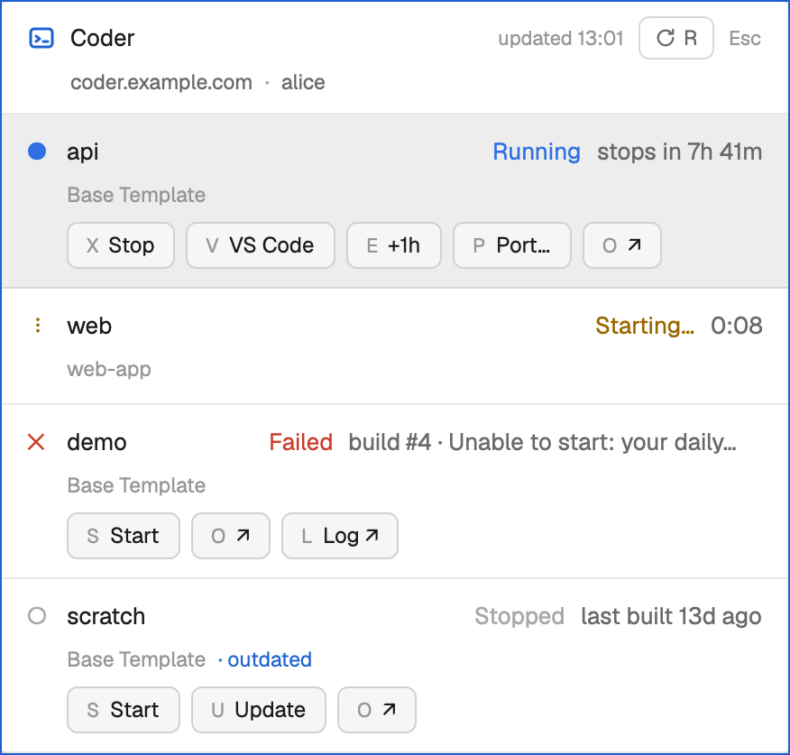

# Coder workspaces

A small window that opens with Cmd+Shift+C anywhere in the Herdr app and lists your Coder workspaces: one row each, with its state, its template, when it will stop by itself and the ports forwarded to it. From the keyboard you start, stop, extend, update, forward a port to, or open VS Code on the highlighted workspace, and Esc closes the window.

This file is the brief: another agent with an empty folder can build the mod from it. The files beside it (`mods/coder/` and `keys.json`) are one build of the brief. If they don't work on your Herdr, build the mod again from what follows.

## What you see

**The window.** 440 px wide, drawn by the app as a movable window with the mod's content in it. It is as tall as its content, up to the end of the list (see below), and it reopens where it was left, including after a restart if it was open at quit. It takes the keyboard when it opens. Colors come from `theme()` only, so it follows light and dark: text is `foreground`, `muted` or `dim`; lines are `border`; state colors are `done`, `working`, `idle`, `blocked` and `accent`.

**The header**, two lines, 14 px padding at the sides and 8 px above and below, 3 px between the lines, and a 1 px `border` line under it.
- *First line:* the Coder glyph (`icons/coder.svg`, 16 px, `accent`); the word "Coder" in semibold `foreground`, taking the free width; `updated HH:MM` (11 px, `dim`, 24-hour clock, the time of the last good refresh), followed by `· out of date` in `blocked` when the latest refresh failed; the Refresh control; and `Esc` (11 px, `dim`). The Refresh control is 24 px tall with 8 px padding, a 6 px radius and a 1 px `input` border, with 11.5 px `muted` text: the refresh icon (`icons/refresh.svg`, 12 px) and the letter `R`. While a refresh is under way its icon is the native spinner.
- *Second line:* indented 24 px, 11.5 px `muted`: the deployment's host, then `·`, then the signed-in user. The host truncates, and the user is at most 150 px wide. If Coder lists but cannot say who is signed in, this line says `Couldn't read who is signed in` in `blocked`.

**The list**, under the header. It stops growing at 672 px (about 8 rows) and scrolls from there. Each workspace is a row with 14 px padding at the sides and 10 px above and below, 6 px between its parts, and a 1 px `border` line under it. The selected row has the `selected` background, and a row under the pointer the `hover` background.
- *First line* (8 px gaps): a 14 px indicator at 13 px (`●` in `done`, `✕` in `blocked`, `○` in `idle`, or a spinner in `working`); the workspace's name in semibold `foreground`, truncating, with a `!` in `blocked` after it when the workspace says it is unhealthy; the state word in the indicator's color; and the detail (at most 230 px, truncating) in `muted`, or `blocked` when it is a warning.
- *Second line* (6 px gaps, indented 22 px, 11.5 px `dim`): the template's name, then `· outdated` in `accent` when the workspace is outdated, then one chip `⇄ <local port>` for each port forwarded to it. A chip is `accent` (`dim` while its forward is still starting), has 5 px of padding and a 4 px radius, and is `hover`-highlighted under the pointer.
- *Buttons* (below, indented 22 px, 6 px gaps, wrapping): each is 26 px tall with 10 px padding, a 6 px radius, a 1 px `input` border, a `raised` background and 12 px `foreground` text. Its key letter comes first, in 11 px `dim`, then its name. A button the pointer is over is drawn at 88% opacity.

**A question** replaces a row's buttons while it is open: the question in `foreground`, then a solid primary button `Enter <verb>` (`solid` background, `solid_foreground` text) and `Esc Cancel`.

**The port box** replaces the buttons too: the line `Forward port`, a 32 px input (8 px radius, 1 px `input` border, `background`, 13 px text) filled with `3000` and selected, the same two buttons (`Enter Forward`, `Esc Cancel`), and, when what was typed can't be used, `Enter a port (3000) or local:workspace (8080:3000).` in `blocked` and the input's border in `blocked`.

**A message** under a row, 12 px, with a `×` (`dim`) to dismiss it: a failure's reason in `blocked`, or a note in `muted` that may end with an `accent` link.

**The whole window** can instead show: a spinner and `Loading workspaces…` before the first list; `The Coder command-line tool isn't installed.` with `Install ↗`; `Not signed in to Coder.` with `Run coder login <url> in a terminal, then press R.`; `Can't reach <host>.` with the reason and `Check your connection or VPN, then press R to retry.`; or `No workspaces yet.` with `Open the dashboard ↗`. Each problem has an `R Retry` button. When a problem comes with an earlier list, the list stays under it, dimmed to half opacity.

## How it behaves

**States.** Rows are ordered by state, then by name ignoring case: running and starting first; then queued, stopping, canceling and deleting; then stopped, canceled and failed.

| Status | Indicator | Word | Detail | Buttons |
|---|---|---|---|---|
| running | `●` `done` | Running | `stops in 7h 42m`, `no auto-stop` or `about to stop`; in `blocked` under 10 minutes; `· at limit` when +1h can't go further | Stop `X`, VS Code `V`, +1h `E`, Port… `P`, Update `U`, Open `O` |
| starting | spinner `working` | Starting… | the time elapsed as `m:ss`, `· queued #N` while queued | none |
| pending, stopping, canceling, deleting | spinner `working` | Queued…, Stopping…, Canceling…, Deleting… | the same | none |
| stopped, canceled | `○` `idle` | Stopped, Canceled | `last built 13d ago` | Start `S`, Update `U`, Open `O` |
| failed | `✕` `blocked` | Failed | `build #4 · <reason>` | Start `S`, Update `U`, Open `O`, Log `L` |

Update is offered only when the workspace is outdated, and +1h only when it can move the stop time later (see below). Open is `↗`, and Log is `Log ↗`.

**Keys**, while the window has the keyboard. Only exact chords count, so `cmd-s` and `shift-s` do nothing.
- `↑` and `↓` move the selection without wrapping. It starts on the workspace selected last time, if it still exists, otherwise on the first row.
- `S` `X` `V` `E` `P` `U` `O` `L` run that action on the selected row, only if the row offers it. Clicking a button does exactly what its letter does, and clicking a row selects it.
- `R` refreshes. `Enter` confirms the open question, and does nothing with none open. `Esc` cancels the open question, or closes the window when there is none. While the port box is open, typing goes into it and the letters do nothing.
- `Cmd+Shift+C` (a global key) opens the window, or closes it when it is open. `Esc` in the mod's own keys section calls the `coder.close` command.

**Actions.** Each runs on exactly the selected workspace, named `<owner>/<name>`. A workspace whose owner or name breaks Coder's own rule for names (`^[a-zA-Z0-9]+(?:-[a-zA-Z0-9]+)*$`) is left out of the list, so no name can reach `coder` as an option.
- *Start* does not wait for the build. *Stop* asks `Stop <name>? Anything running in it ends.` and *Update* on a running workspace asks `Update <name>? It restarts on the new version.`; Enter confirms. Update on a stopped workspace doesn't ask.
- *+1h* moves the automatic stop one hour later, never past the template's limit: if the limit cuts it short, the row says `Extended to the template's limit (stops in …).` It is offered only when the new stop time is later and at least 30 minutes away. It never shortens the day.
- *VS Code* opens VS Code connected to the workspace. *Open* and *Log* open the workspace's page, or the failed build's log, in the browser; only `http` and `https` links are ever opened.
- *Port…* opens the port box. `3000` forwards local 3000 to workspace 3000, and `8080:3000` forwards local 8080 to workspace 3000. Each side is a whole number from 1 to 65535.

**While an action is under way** the row shows its word at once (`Starting…`, `Stopping…`, `Updating…`) with the elapsed time, and no buttons. It settles when the workspace's own state says so. When it ends, a notification says `<name> is running`, `<name> stopped` or `<name> updated`, or `Couldn't start <name>` (and likewise for stop and update) with the reason. After 90 s with no change the row says `No change yet.` with `Check the dashboard ↗`. A failure's reason stays under the row until dismissed.

**Forwards.** A forward is a terminal on this computer, started in the background without moving the person's view, as a tab named `<name> :<local port>` in a space named `Coder`, or, if there is no such space, in the first space on this computer, or in a new space named `Coder` if there is none. It is labelled so the mod can find it again, even after a restart. The chip shows `dim` for its first 10 seconds, then `accent`; clicking it brings the tab into view, and closing the tab ends the forward. A forward that stops within 10 seconds failed, and the row says `Port <local>: <reason>`, for example `bind: address already in use`, and removes the terminal.

**Refreshing.** A refresh runs `coder list`. The next one starts 30 s after the last ends, or 3 s after while anything is in progress (a build, an action, a forward starting), and 30 s after a failed one. Only one runs at a time: `R` pressed during one is acknowledged and queues one more for when it ends, and pressing it again adds nothing. Nothing refreshes while the window is closed.

## Built from

**`mod.json`:** `{ "place": "none", "version": "<the release>", "title": "Coder", "overlay": { "kind": "popup", "width": 1, "height": 1, "frame": "none" } }`. One mod, two roles. The 1×1 frameless popup is a *launcher*: the shortcut `mod.open:coder` opens it, and it either closes the window named in the shared key `coder.window`, or opens the window with `openOverlay({ mod: "coder", props: { role: "panel" }, kind: "window", key: "coder", keep: true, width: 440 })`. It then closes itself with `closeOverlay`. The window is the same mod with `props.role === "panel"`.

**`keys.json`:** `{ "global": { "cmd-shift-c": "mod.open:coder" }, "mod:coder": { "escape": "coder.close" } }`.

**Files**, plain JavaScript modules, no dependencies:
- `model.js` imports nothing and never reads the clock (callers pass `now`). It decides everything: reading `coder list --output json` into workspaces, their rows, which actions each state offers, the countdowns and ages, the +1h rule, how a refresh is scheduled, how an action settles, how a typed port is read, every command's arguments, every link, and every sentence above.
- `coder.js` makes every call to the outside: the `coder` tool through `exec` (30 s limit), `hc` for forwards, `open` or `xdg-open` for links, and the app's `tab.rename`, `space.rename` and `pane.focus` commands through `run`.
- `ui.js` builds the elements from what `model.js` decided, with `gpui-kit` and `gpui-base`. It decides nothing.
- `main.js` is the `View` class: the launcher, the window's state, the refresh timer, the keys and the wiring.

**From `herdr`:** `exec`, `hc`, `home`, `run`, `window`, `closeOverlay`, `openOverlay`, `notify`, `props`, `shared`, `setShared`, `nextCommand` (it answers `close` and `refresh`), `spaces`, `terminals` and `theme`.

**Programs it runs**, each with its arguments as separate values and never through a shell:

| To | Command |
|---|---|
| List workspaces | `coder list --output json` |
| Know where you are signed in | `coder whoami --output json` |
| Start | `coder start --no-wait <owner/name>` |
| Stop | `coder stop -y <owner/name>` |
| Update | `coder update --use-parameter-defaults <owner/name>` |
| +1h | `coder schedule extend <owner/name> <N>m` |
| VS Code | `coder open vscode <owner/name>` |
| Forward | `hc run --bg --json --no-parent --no-notify --cwd <home> --label herdr.space=<id> --label herdr.tab=<id> --label coder.forward=<owner/name>@<L>:<R> -- /usr/bin/env coder port-forward <owner/name> --tcp <L>:<R> --disable-autostart`, then `hc get`, `hc read` and `hc rm` |
| Open a link | `open <url>` on macOS, `xdg-open <url>` elsewhere |

**Icons:** two SVGs of the mod's own, 16 by 16, a 1.5 stroke with round ends and joins, drawn in the text color. `coder.svg` is a rounded rectangle (`x=2 y=3 width=12 height=10 rx=2`) with a `>` prompt and an underscore inside it. `refresh.svg` is a three-quarter circle with an arrowhead.

## Watch out

- **`exec` is limited to 30 s and 8 MiB of output.** A command that takes longer ends as `pending`, not as a failure: the workspace's own build says how it went. Start, Stop and Update never wait for the build.
- **Port forwards run on this computer**, through herdr-core, with `--disable-autostart`, so a forward can never start a stopped workspace. They are never given `--on`, so no command runs on another machine.
- **`hc run` starts a template instead of a program** when its first word names one. That is why the forward runs `/usr/bin/env coder …` and not a bare `coder`: a person's `hc` template called `coder` must never take its place.
- **The folder name `coder` is wired into** the keys (`mod.open:coder`, `mod:coder`), the `coder.close` command and the icon paths (`mods/coder/icons/...`). A copy under another name won't work.
- **Refreshing is 30 s while nothing changes and 3 s while something does**, one read at a time. Anything faster redraws the whole app window for nothing.
- **Escape arrives twice**: once at the mod's key handler and once as the `coder.close` command. A press that has cancelled a question must not also close the window; ignore the second delivery for about 200 ms.
- **Focus.** Calling `focus()` in `init` alone doesn't give the window the keyboard, because the element isn't drawn yet. Ask again about 250 ms later.
- **Never act on a key with a modifier**, and never run a command through a shell. A workspace name is data, not a command.
- **Nothing is stored or sent**: no token, no web API, no files read or written. Use only `theme()` colors, and only the two icons.

## Done when

- `herdr-app check` passes on the folder.
- Cmd+Shift+C opens the window, and Esc closes it.
- The list matches `coder list` for the person's own workspaces, with the right word, indicator and buttons for each state.
- `O` on a workspace opens its page in the browser.
- `R` refreshes, and the `updated` time changes.
- Stop and Update on a running workspace ask first, and Esc cancels the question.
- The port box forwards a port: a `⇄` chip appears on the row, and closing its tab ends the forward.
- With `coder` signed out, the window says `Not signed in to Coder.` and what to run.
